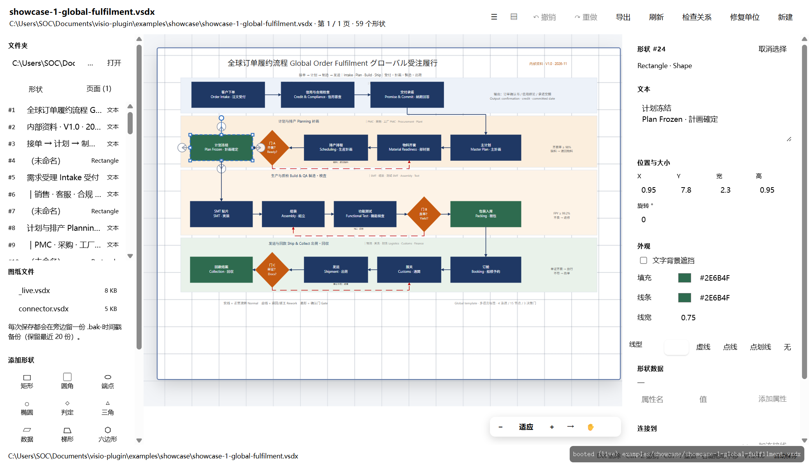
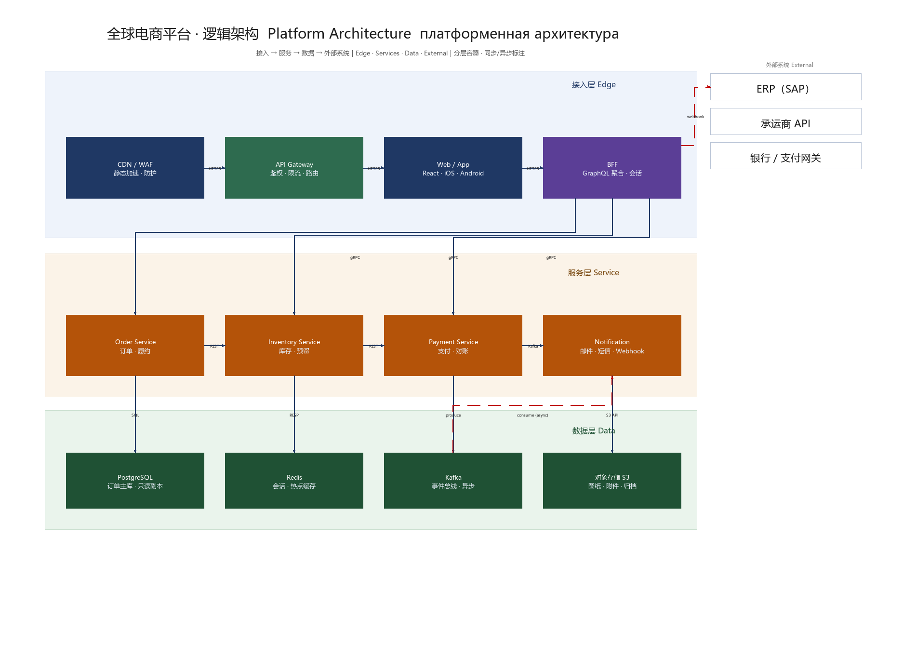

# dsh-visio

[](https://github.com/SamyiHu/dsh-visio/actions/workflows/ci.yml)

A native **Visio (.vsdx) viewer and editor for the DeepSeek Harness (DSH) Web UI**, with a
live preview, shape editing and a `visio` agent tool.  The core engine is Python standard
library, with no Visio install and no Office dependency; PNG export, `snapshot` and stencil
previews additionally need [Pillow](https://pillow.readthedocs.io/) (`engine/vsdx_png.py`,
`engine/svg_raster.py`).

English · [简体中文](README.md)


## Screenshots

| Panel | Shape selected (editable) |
|---|---|
|  |  |

Select a connector to change its end directions and line style:


## Showcase

| Sample | What it shows | Languages |
|---|---|---|
| [Global order fulfilment](examples/showcase/showcase-1-global-fulfilment.vsdx) | 4 swimlanes / 15 nodes / 3 gates / 3 rework loops | zh · en · ja |
| [Platform architecture](examples/showcase/showcase-2-platform-architecture.vsdx) | Edge / service / data layers plus external systems | zh · en · ru |




## Features

- **Live preview** – the panel renders the `.vsdx` page to SVG and repaints after every edit.
- **Edit in place** – move / resize, text, fill, line, per-run text colour, shape data.
- **Shape library** – 16 built-in kinds (process, decision, terminator, …) plus
  `.vssx`/`.vstx` stencil import; built-ins are written as real ShapeSheet geometry rows
  (`RelMoveTo`/`RelLineTo` + `Rounding` cells), not lines painted on a preview layer, so the
  outline is identical when the file is opened in Visio.
- **Connectors** – add, label, delete; connectors keep their own line colour, weight and
  arrow heads, and their labels are read from the 1-D shape text.
- **Relationship audit** – `validate` finds empty links (connectors with no `Connect` rows),
  dangling ids, floating endpoints and zero-size shapes.
- **Multi-page, zoom, pan, grid, undo/redo**, external-change detection.
- **Agent tool** – the same operations are exposed to the model as a `visio` tool, including
  stencil discovery (`stencil_info`, `stencil_sheet`), whole-drawing snapshots (`snapshot`)
  and a self-describing `capabilities` action.

## Install

**From the plugin market (recommended):** open Settings → Plugins in DSH, search `dsh-visio`, install. Or:

```bash
dsh plugin --profile desktop add dsh-visio
```

npm package: <https://www.npmjs.com/package/dsh-visio> (`latest` = 1.24.1).

To see it under **Plugins → Discover**, add the community index source:

```
Settings → Plugins → Discover → Index sources
https://cdn.jsdelivr.net/npm/dsh-plugin-catalog/index.json
```

GitHub source still works as a fallback:

```bash
dsh plugin --profile desktop add github:SamyiHu/dsh-visio
```

**Local development:** add `"dsh-visio": "link:/absolute/path/to/dsh-visio"` to the profile
`package.json`, run `pnpm install`, then reload the app. The bundle patch
`cordis.patch.yml` inserts the plugin automatically.

Requires Python 3.9+ on `PATH` (or set `pythonPath` in the plugin config / `DSH_VISIO_PYTHON`). For PNG export / snapshots / stencil previews, install Pillow for that interpreter: `python -m pip install Pillow`.

## Usage

- Sidebar → **Visio 图纸** opens the panel; the floating canvas button opens the same
  drawing in a draggable window.
- Pick a folder, click a `.vsdx`; the left tree lists pages and shapes, the right pane edits
  the selection.
- From the agent side: ask for a drawing and the model calls the `visio` tool:
  `open`, `text`, `get_shape`, `list`, `create`, `add_shape`, `add_freeform`, `move`, `align`, `swimlane`,
  `set_text`, `set_cell`, `set_prop`, `delete`, `duplicate`, `validate`, `audit_full`,
  `connect`, `connect_styled`, `probe`, `route_style`, `set_route`, `bend`, `clear_route`,
  `move_endpoint`, `set_end_direction`, `add_anchor`, `kinds`, `guide`, `shape_list`, `shape_save`,
  `stencils`, `stencil_info`, `stencil_sheet`, `stencil_add`, `snapshot`, `capabilities`,
  `undo`, `redo`, `normalize`, `export`.
  `examples/basic-shapes.vssx` is a three-master stencil used by the tests.

  The tool schema's `action` enum is generated from the implementation table:
  **an advertised action always has an implementation, and an implemented action is always
  advertised**; the parameter table and the arguments each handler reads are kept aligned by
  the tests (`tests/test_host_contract.mjs`). Any failure is returned as a **tool error**
  instead of success-looking text.

## Configuration

| key | default | meaning |
|---|---|---|
| `pythonPath` | `python` | interpreter used for the engine |
| `defaultFolder` | workspace dir | where the file browser starts |
| `agentTool` | `true` | whether the `visio` tool is registered for the agent; the Agent switch in the panel header toggles it at runtime (remembered in `~/.dsh/visio-agent.json`), `false` starts disabled |

## Compatibility

| component | requirement | notes |
|---|---|---|
| Node.js | **>= 18** | Host half `index.js` uses ESM, `node:` imports and `import.meta.url`; CI runs on Node 20 |
| Python | **>= 3.9** | Engine interpreter: `python` on Windows, `python3` elsewhere; override with `pythonPath` / `DSH_VISIO_PYTHON`. CI runs on 3.12 |
| Pillow | optional | Only PNG export, `snapshot` and stencil previews need it; core read/write and SVG rendering are stdlib |
| DSH host | `>=0.1.7-rc.2` (`dsh.engines.dsh`); **guaranteed on `0.2.2-rc.1`** | desktop profile / Web UI plugin. The build it was first developed against (2026-10-28 first commit) works, but its exact version was not recorded; some earlier builds may work and are not guaranteed. `peerDependencies["@deepseek-ai/dsh"]` lists each prerelease branch explicitly so semver does not silently exclude prereleases |

Machine-readable declarations live in `package.json`: `engines.node`, `dsh.engines.dsh` (informational; pnpm only WARNs by default) and `peerDependencies["@deepseek-ai/dsh"]` (the range npm/pnpm actually validates). Python / Pillow are runtime prerequisites of the plugin itself, see above.

## Architecture

```
index.js            Host half: `visio` tool + same-origin routes, bridge pool
client.js           Client half: panel, floating window, inspector, i18n
engine/vsdx_core.py Reader/editor/renderer (OPC + XML, stdlib only; PNG paths use Pillow)
engine/visio_bridge.py  JSON line protocol used by the Host
engine/blank_doc.py     Creates a minimal valid .vsdx from scratch
engine/kinds.py         16 built-in shape kinds (ShapeSheet geometry rows + Rounding)
engine/stencil.py       .vssx/.vstx import
tests/                  engine, tool end-to-end, client-render, client-contract, host-contract
```

The Host keeps one engine child process per interpreter and **restarts it when any
`engine/*.py` / `engine/*.json` file changes** (mtime + size fingerprint, file list from a
directory scan instead of a hand-kept list), so edits never run on stale code.

## Development

```bash
python tests/test_engine.py          # engine: edits, connectors, undo, export, snapshots, style-injection guards
node tests/test_tool_integration.mjs # end-to-end: real engine drives build→connect→audit→export→undo
node tests/test_host_contract.mjs    # tool schema ↔ handler table ↔ bridge actions, path guard, fingerprint, real round trip
node tests/test_client_contract.mjs  # zh/en key parity, no hard-coded Chinese, no debug leftovers, CLIENT_BUILD == package version
node tests/test_client_render.mjs    # renders panel/inspector/dialog headlessly
node tests/make_uicheck.mjs          # inspector layout page, measurable in a real browser
```

The published package ships `tests/`, so the suite can run straight from `node_modules`.

## Limitations

- SVG preview approximates Visio typography (line breaking by width estimate).
- **Master instances and groups do not participate in the preview**: `_master_layers` merges
  only master cells (colour/font/text anchors), not master `Geometry`; group children
  (`depth > 0`) are skipped while rendering. Drawings made from official Visio stencils or
  groups may show only text. `stencil_add` works around this by flattening master geometry
  into inline rows on the instance.
- **PNG export uses a hand-rolled rasterizer** (`engine/svg_raster.py`, regex-matching
  rect/ellipse/path/text): no `transform` support (rotated shapes export upright), no
  `<line>`, arrow markers in `<defs>` are dropped. For pixel-accurate output use a browser
  screenshot or `export format=svg`.
- Preview text truncates at 8 lines × 120 chars; `formatState` lists the first 60 shapes
  (with an explicit note beyond that).
- Themes/masters are honoured for geometry and colour, not for every style inheritance rule.
- `set_cell` with a literal value **deletes the cell's formula** (the `F` attribute),
  breaking theme inheritance/geometry constraints; edit formula-bearing drawings in Visio.
- The undo/redo stack lives in the engine process memory (25 steps): any engine restart
  (30 s timeout, engine file change, host reload) clears it, and the panel and agent share
  one stack. On-disk rollback relies on `<file>.bak-<timestamp>` (20 kept by default).
- Saving rewrites the whole zip (entry timestamps reset) and repacks `.vsdm` — macros are
  not executed, and a digital signature is invalidated.
- The `/dsh-visio/op` route checks same-origin; writes go through the path guard
  (`guardRequest`): `export` / `stencil_sheet` output must land in a folder opened in the
  panel and end in `.svg` / `.png`, while reads still accept any absolute path (the engine
  only opens .vsdx/.vsdm/.vssx/.vstx). The engine is the last line of defence: an `out` that
  points at the drawing itself or has the wrong suffix is refused.
- There is no file lock: a drawing open in Visio can still be written, so avoid editing the
  same file on both sides at once.

## Licence

MIT — see [LICENSE](LICENSE).  No third-party fixtures are bundled; tests build their own documents.

## CI

`.github/workflows/ci.yml` runs on every push/PR across Linux and Windows:

- `node --check` on both halves, `py_compile` on the engine
- `tests/test_engine.py` (40 cases: edits, connectors, undo, exports, snapshots)
- `tests/test_client_render.mjs` and `tests/test_client_contract.mjs` (slots + translations)
- `tests/test_host_contract.mjs` (tool schema, handler table, path guard, real bridge round trip)

`release.yml` publishes a zip on every `v*` tag, after the same test suite, and refuses a tag
that does not match `package.json` version.
