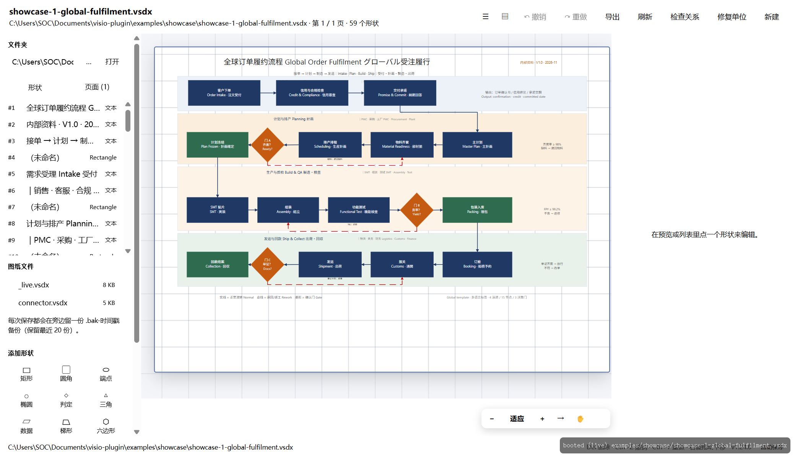
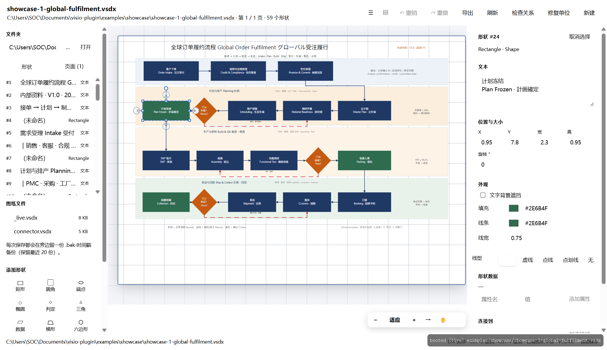
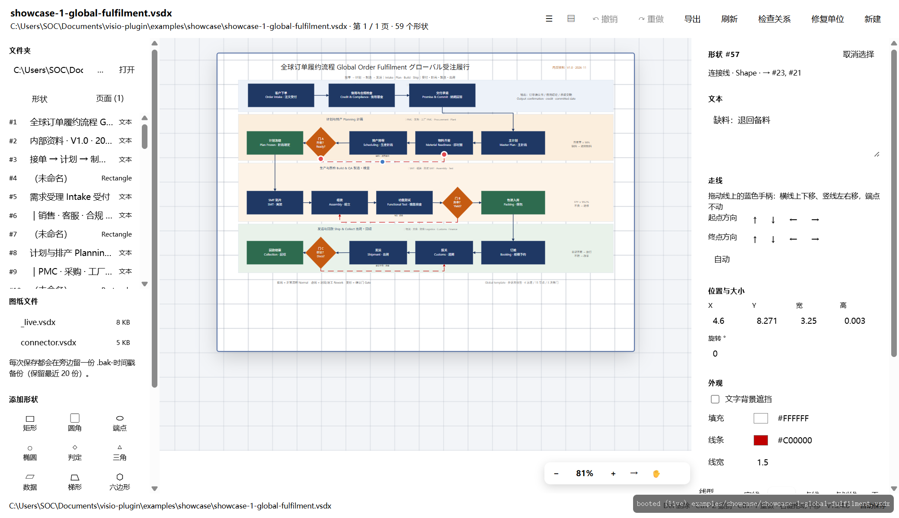
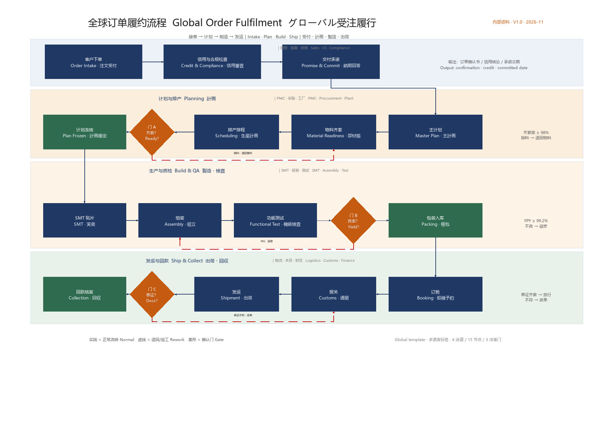
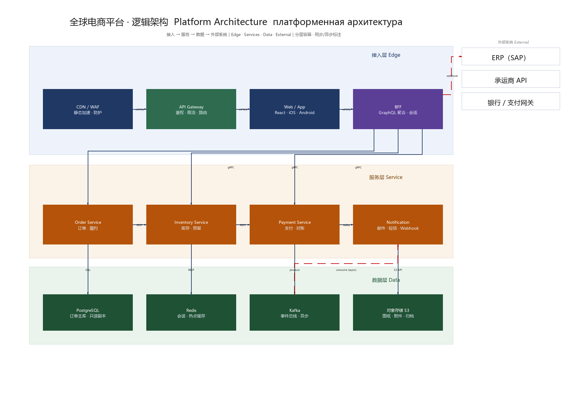

# dsh-visio

[](https://github.com/SamyiHu/dsh-visio/actions/workflows/ci.yml)

A native **Visio (.vsdx) viewer and editor for the DeepSeek Harness (DSH) Web UI**, with a
live preview, shape editing and a `visio` agent tool.  The core engine is Python standard
library, with no Visio install and no Office dependency; PNG export, `snapshot` and stencil
previews additionally need [Pillow](https://pillow.readthedocs.io/) (`engine/vsdx_png.py`,
`engine/svg_raster.py`).

English · [简体中文](README.md)


## Screenshots

| Panel | Shape selected (editable) |
|---|---|
|  |  |

Select a connector to change its end directions and line style:



## Showcase

| Sample | What it shows | Languages |
|---|---|---|
| [Global order fulfilment](examples/showcase/showcase-1-global-fulfilment.vsdx) | 4 swimlanes / 15 nodes / 3 gates / 3 rework loops | zh · en · ja |
| [Platform architecture](examples/showcase/showcase-2-platform-architecture.vsdx) | Edge / service / data layers plus external systems | zh · en · ru |





## Features

- **Live preview** – the panel renders the `.vsdx` page to SVG and repaints after every edit.
- **Edit in place** – move / resize, text, fill, line, per-run text colour, shape data.
- **Shape library** – 16 built-in kinds (process, decision, terminator, …) plus
  `.vssx`/`.vstx` stencil import; drawn from real Visio masters, not stacked lines.
- **Connectors** – add, label, delete; connectors keep their own line colour, weight and
  arrow heads, and their labels are read from the 1-D shape text.
- **Relationship audit** – `validate` finds empty links (connectors with no `Connect` rows),
  dangling ids, floating endpoints and zero-size shapes.
- **Multi-page, zoom, pan, grid, undo/redo**, external-change detection.
- **Agent tool** – the same operations are exposed to the model as a `visio` tool, including
  stencil discovery (`stencil_info`, `stencil_sheet`), whole-drawing snapshots (`snapshot`)
  and a self-describing `capabilities` action.

## Install

**From the plugin market (recommended):** open Settings → Plugins in DSH, search `dsh-visio`, install. Or:

```bash
dsh plugin --profile desktop add dsh-visio
```

> No npm release yet? Install straight from GitHub:
> ```bash
> dsh plugin --profile desktop add github:SamyiHu/dsh-visio
> ```

**Local development:** add `"dsh-visio": "link:/absolute/path/to/dsh-visio"` to the profile
`package.json`, run `pnpm install`, then reload the app. The bundle patch
`cordis.patch.yml` inserts the plugin automatically.

Requires Python 3.9+ on `PATH` (or set `pythonPath` in the plugin config / `DSH_VISIO_PYTHON`). For PNG export / snapshots / stencil previews, install Pillow for that interpreter: `python -m pip install Pillow`.

## Usage

- Sidebar → **Visio 图纸** opens the panel; the floating canvas button opens the same
  drawing in a draggable window.
- Pick a folder, click a `.vsdx`; the left tree lists pages and shapes, the right pane edits
  the selection.
- From the agent side: ask for a drawing and the model calls the `visio` tool
  (`open`, `text`, `get_shape`, `list`, `create`, `add_shape`, `move`, `set_text`, `set_cell`,
  `set_prop`, `connect`, `delete`, `validate`, `kinds`, `stencils`, `stencil_info`,
  `stencil_sheet`, `stencil_add`, `snapshot`, `capabilities`, `undo`, `redo`, `normalize`,
  `export`).  `examples/basic-shapes.vssx` is a three-master stencil used by the tests.

## Configuration

| key | default | meaning |
|---|---|---|
| `pythonPath` | `python` | interpreter used for the engine |
| `defaultFolder` | workspace dir | where the file browser starts |

## Compatibility

| component | requirement | notes |
|---|---|---|
| Node.js | **>= 18** | Host half `index.js` uses ESM, `node:` imports and `import.meta.url`; CI runs on Node 20 |
| Python | **>= 3.9** | Engine interpreter: `python` on Windows, `python3` elsewhere; override with `pythonPath` / `DSH_VISIO_PYTHON`. CI runs on 3.12 |
| Pillow | optional | Only PNG export, `snapshot` and stencil previews need it; core read/write and SVG rendering are stdlib |
| DSH host | `>=0.1.7-rc.2` (`dsh.engines.dsh`); **guaranteed on `0.2.2-rc.1`** | desktop profile / Web UI plugin. The build it was first developed against (2026-10-28 first commit) works, but its exact version was not recorded; some earlier builds may work and are not guaranteed. `peerDependencies["@deepseek-ai/dsh"]` lists each prerelease branch explicitly so semver does not silently exclude prereleases |

Machine-readable declarations live in `package.json`: `engines.node`, `dsh.engines.dsh` (informational; pnpm only WARNs by default) and `peerDependencies["@deepseek-ai/dsh"]` (the range npm/pnpm actually validates). Python / Pillow are runtime prerequisites of the plugin itself, see above.

## Architecture

```
index.js            Host half: `visio` tool + same-origin routes, bridge pool
client.js           Client half: panel, floating window, inspector, i18n
engine/vsdx_core.py Reader/editor/renderer (OPC + XML, stdlib only; PNG paths use Pillow)
engine/visio_bridge.py  JSON line protocol used by the Host
engine/blank_doc.py     Creates a minimal valid .vsdx from scratch
engine/kinds.py         16 built-in shape kinds (real master geometry)
engine/stencil.py       .vssx/.vstx import
tests/                  engine, client-render, client-contract, host-contract
```

The Host keeps one engine child process per interpreter and **restarts it when any
`engine/*.py` file changes** (mtime + size fingerprint), so edits never run on stale code.

## Development

```bash
python tests/test_engine.py          # 15 engine cases (edit, connectors, stencils, snapshots)
node tests/test_client_render.mjs    # renders panel/inspector/dialog headlessly
node tests/test_client_contract.mjs  # i18n keys + slot contract
node tests/test_host_contract.mjs    # tool schema + routes + bridge round trip
node tests/make_uicheck.mjs          # inspector layout page, measurable in a real browser
```

## Limitations

- SVG preview approximates Visio typography (line breaking by width estimate).
- Themes/masters are honoured for geometry and colour, not for every style inheritance rule.
- `.vsdm` macros are not executed.

## Licence

MIT — see [LICENSE](LICENSE).  No third-party fixtures are bundled; tests build their own documents.

## CI

`.github/workflows/ci.yml` runs on every push/PR across Linux and Windows:

- `node --check` on both halves, `py_compile` on the engine
- `tests/test_engine.py` (15 cases: edit, connectors, stencils, snapshots)
- `tests/test_client_render.mjs` and `tests/test_client_contract.mjs` (slots + 94 translations)
- `tests/test_host_contract.mjs` (tool schema, routes, bridge round trip)

`release.yml` publishes a zip on every `v*` tag, after the same test suite, and refuses a tag
that does not match `package.json` version.
