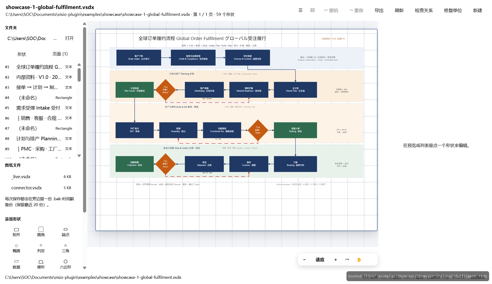
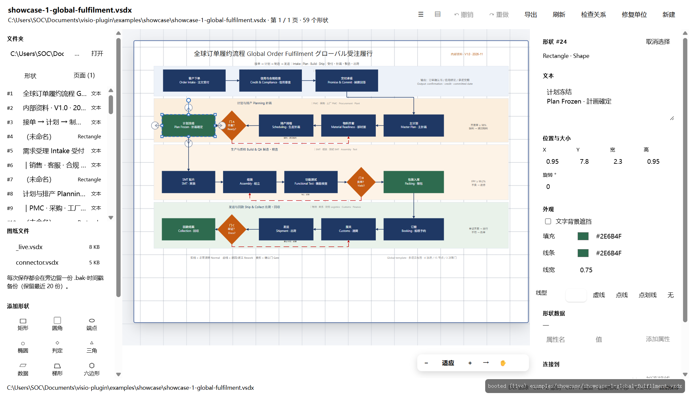
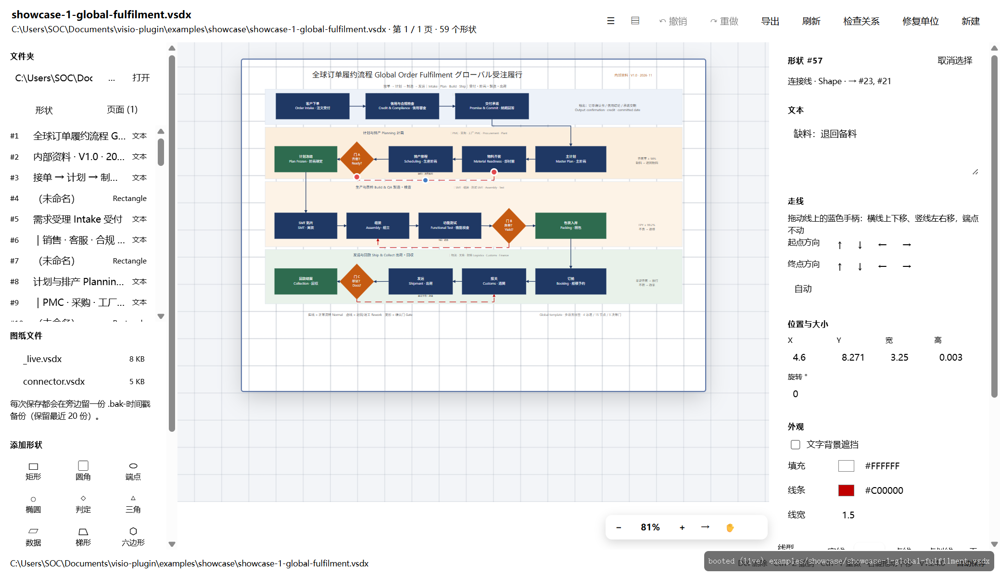
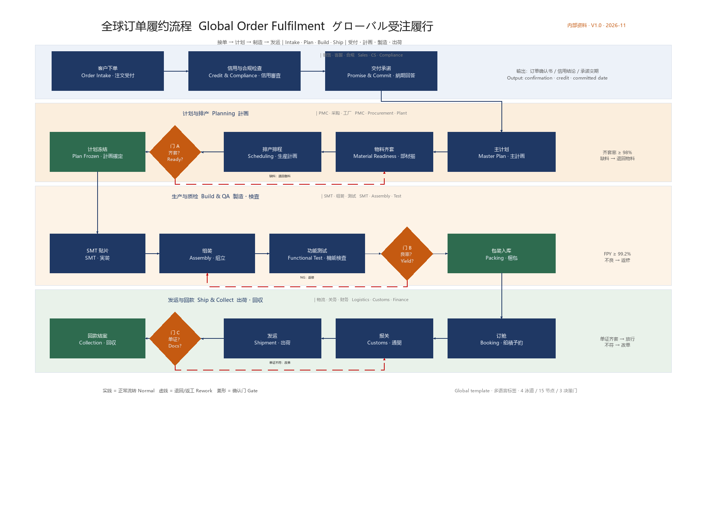
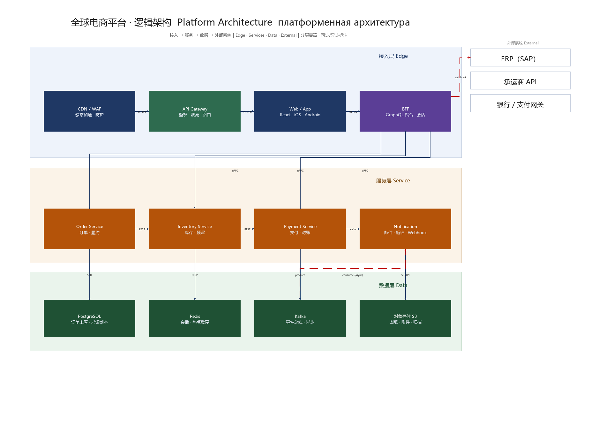

# dsh-visio

[](https://github.com/SamyiHu/dsh-visio/actions/workflows/ci.yml)

**在 DeepSeek Harness（DSH）Web 界面里直接看和改 Visio 图纸（.vsdx）的插件**：实时预览、形状编辑，外加一个给 Agent 用的 `visio` 工具。

引擎主体（.vsdx 读写、渲染、编辑）只用 Python 标准库，**不需要装 Visio，也不依赖 Office**；PNG 导出、`snapshot` 快照和模具预览图额外需要 [Pillow](https://pillow.readthedocs.io/)（`engine/vsdx_png.py`、`engine/svg_raster.py`）。

[English](README.en.md) · 简体中文


## 截图

| 面板 | 选中形状（可编辑） |
|---|---|
|  |  |

选中连接线后，可调起点/终点方向与线型：



## 展示案例

| 案例 | 内容 | 语言 |
|---|---|---|
| [全球订单履约](examples/showcase/showcase-1-global-fulfilment.vsdx) | 4 泳道 / 15 节点 / 3 决策门 / 3 条退回线 | 中 · 英 · 日 |
| [平台逻辑架构](examples/showcase/showcase-2-platform-architecture.vsdx) | 接入/服务/数据三层容器 + 外部系统 | 中 · 英 · 俄 |





## 功能

- **实时预览**：面板把 `.vsdx` 页面渲染成 SVG，每次改动后立即重绘。
- **就地编辑**：移动/缩放、文字、填充、线条、逐行文字颜色、形状数据。
- **形状库**：内置 16 种图形（流程、判定、起止……），支持导入 `.vssx` / `.vstx` 模具；内置图形写成 ShapeSheet 几何行（`RelMoveTo`/`RelLineTo` + `Rounding` 单元格），不是预览层画的线，所以 Visio 里打开也是同一个轮廓。
- **连接线**：新增、加标签、删除；线自己的颜色/线宽/箭头都保留，标签从 1-D 形状的文字里读。
- **关系检查**：`validate` 能找出空连接（没有 `Connect` 行的线）、悬空 ID、漂移端点、零尺寸形状。
- **多页、缩放、平移、网格、撤销/重做**，以及文件被外部修改时的自动检测。
- **Agent 工具**：同一套能力以 `visio` 工具暴露给模型，含模具发现（`stencil_info`、`stencil_sheet`）、整图快照（`snapshot`）和自描述的 `capabilities`。

## 安装

**从插件市场安装（推荐）**：DSH 里打开 Settings → Plugins，搜 `dsh-visio` 点安装；或命令行：

```bash
dsh plugin --profile desktop add dsh-visio
```

npm 包：<https://www.npmjs.com/package/dsh-visio>（`latest` = 1.24.1）。

想在 **Plugins → Discover / 插件市场** 里看到它，需要先给 DSH 加一个索引源：

```
Settings → Plugins → Discover → Index sources
https://cdn.jsdelivr.net/npm/dsh-plugin-catalog/index.json
```

GitHub 源仍可直装（备用）：

```bash
dsh plugin --profile desktop add github:SamyiHu/dsh-visio
```

**本地开发**：在 profile 的 `package.json` 里加 `"dsh-visio": "link:/absolute/path/to/dsh-visio"`，执行 `pnpm install`，再重载应用。插件自带 `cordis.patch.yml`，会自动插入。

需要 `PATH` 里有 Python 3.9+（或在插件配置里设 `pythonPath`，或设环境变量 `DSH_VISIO_PYTHON`）；若要用 PNG 导出 / 快照 / 模具预览，还需为该解释器安装 Pillow：`python -m pip install Pillow`。

## 使用

- 侧栏 → **Visio 图纸** 打开面板；浮动画布按钮可以把同一张图放进可拖动的独立窗口。
- 选目录 → 点一个 `.vsdx`：左边树列页面和形状，右边改选中形状的属性。
- Agent 侧直接说需求即可，模型会调 `visio` 工具：
  `open`、`text`、`get_shape`、`list`、`create`、`add_shape`、`add_freeform`、`move`、`align`、`swimlane`、
  `set_text`、`set_cell`、`set_prop`、`delete`、`duplicate`、`validate`、`audit_full`、
  `connect`、`connect_styled`、`probe`、`route_style`、`set_route`、`bend`、`clear_route`、
  `move_endpoint`、`set_end_direction`、`add_anchor`、`kinds`、`guide`、`shape_list`、`shape_save`、
  `stencils`、`stencil_info`、`stencil_sheet`、`stencil_add`、`snapshot`、`capabilities`、
  `undo`、`redo`、`normalize`、`export`。
  `examples/basic-shapes.vssx` 是测试用的三母版模具。

  工具 schema 的 `action` 枚举由实现表自动生成：**广告了就一定有实现，有实现就一定广告**；
  参数表与 handler 读取的参数由测试互相对齐（`tests/test_host_contract.mjs`）。任何失败都以
  **工具报错**返回，不再伪装成成功文本。

## 配置

| 键 | 默认值 | 含义 |
|---|---|---|
| `pythonPath` | `python` | 引擎使用的解释器 |
| `defaultFolder` | 工作目录 | 文件浏览器起始目录 |
| `agentTool` | `true` | 是否把 `visio` 工具注册给 Agent；面板头部的 Agent 开关可随时运行时切换（记忆在 `~/.dsh/visio-agent.json`），设为 `false` 则默认关闭 |

## 兼容性

| 组件 | 要求 | 说明 |
|---|---|---|
| Node.js | **≥ 18** | 宿主半 `index.js` 用 ESM + `node:` 前缀导入 + `import.meta.url`；CI 在 Node 20 上跑 |
| Python | **≥ 3.9** | 引擎解释器，默认 Windows 用 `python`、其他系统用 `python3`；可用 `pythonPath` / `DSH_VISIO_PYTHON` 指定。CI 在 3.12 上跑 |
| Pillow | 可选 | 仅 PNG 导出、`snapshot`、模具预览需要；核心读写与 SVG 渲染是标准库 |
| DSH 宿主 | `>=0.1.7-rc.2`（`dsh.engines.dsh`）；**保证 `0.2.2-rc.1`** | desktop profile / Web UI 插件。初制作期（2026-10-28 首版）的版本可用但仓库未记录确切号；更早的部分 0.2.x 之前版本可能可用、不保证。`peerDependencies["@deepseek-ai/dsh"]` 显式列出各预发布分支，避免 semver 静默排除 prerelease |

机器可读声明在 `package.json`：`engines.node`、`dsh.engines.dsh`（声明性，pnpm 默认只 WARN）与 `peerDependencies["@deepseek-ai/dsh"]`（npm/pnpm 真正校验的范围）。Python / Pillow 为插件自身运行前置，见上表。

## 结构

```
index.js                 Host 侧：`visio` 工具 + 同源路由、引擎进程池
client.js                Client 侧：面板、浮窗、属性检查器、i18n
engine/vsdx_core.py      读写渲染核心（OPC + XML，纯标准库）
engine/visio_bridge.py   Host 调用的 JSON 行协议
engine/blank_doc.py      从零生成最小可用 .vsdx
engine/kinds.py          16 种内置图形（ShapeSheet 几何行 + Rounding）
engine/stencil.py        .vssx/.vstx 导入
tests/                   引擎、工具端到端、客户端渲染、客户端契约、Host 契约
```

Host 按解释器各留一个引擎子进程，并**在任意 `engine/*.py` / `engine/*.json` 变化时重启**（mtime + size 指纹，文件列表用目录扫描得到，不再手工维护），避免改完还跑旧代码。

## 开发与测试

```bash
python tests/test_engine.py          # 引擎：编辑、连线、撤销、导出、快照、颜色注入防护
node tests/test_tool_integration.mjs # 端到端：用真实引擎跑 visio 工具的建图→连线→检查→导出→撤销
node tests/test_host_contract.mjs    # 工具 schema ↔ 实现表 ↔ 桥动作、路径守卫、指纹覆盖、真实桥往返
node tests/test_client_contract.mjs  # 中英词条对齐、无硬编码中文、无调试残留、CLIENT_BUILD 与版本一致
node tests/test_client_render.mjs    # 无头渲染面板/检查器/新建对话框
node tests/make_uicheck.mjs          # 生成右栏布局页，可在真浏览器里量尺寸
```

发布包包含 `tests/`，装到 `node_modules` 之后也能直接跑。

## 已知限制

- SVG 预览对排版是近似（按宽度估算换行），和 Visio 不保证逐像素一致。
- **母版实例与编组的几何不参与预览**：`_master_layers` 只合并母版的单元格（颜色/字体/文字锚点），没有合并母版的 `Geometry`；编组子形状（`depth > 0`）在渲染时被跳过。用 Visio 官方模具或编组画出来的图，预览里可能只剩文字。`stencil_add` 靠把母版几何摊平进实例内联行来绕开这一点。
- **PNG 导出走的是自制栅格器**（`engine/svg_raster.py`，正则匹配 rect/ellipse/path/text）：不支持 `transform`（旋转形状导出后是正的）、不认 `<line>`、`<defs>` 里的箭头标记会被丢弃。要逐像素一致请用浏览器截图或 `export format=svg`。
- 预览文字按 8 行、每行 120 字符截断；`formatState` 只列前 60 个形状（超出会明确提示）。
- 主题/母版对几何和颜色的处理是有的，但不是每条样式继承规则都实现。
- `set_cell` 写入字面值时会**删除该单元格的公式**（`F` 属性），主题继承/几何约束因此断开；需要保留公式的图请在 Visio 里改。
- 撤销/重做栈在引擎进程内存里（25 步）：引擎重启（30s 超时、引擎文件改动、宿主重载）即清空，且面板与 agent 共用同一个栈。磁盘侧的回滚靠 `<文件>.bak-<时间戳>`（默认保留 20 份）。
- 每次保存都会整包重写 zip（entry 时间戳归零），并对 `.vsdm` 重打包——宏不执行，但数字签名会失效。
- Web 路由 `/dsh-visio/op` 做同源校验；写入受路径守卫约束（`guardRequest`）：`export` / `stencil_sheet` 的输出只能落在面板打开过的目录里且必须是 `.svg` / `.png`，读操作仍接受任意绝对路径（引擎只认 `.vsdx/.vsdm/.vssx/.vstx`）。引擎侧还有最后一道防线：`out` 指向图纸本身或后缀不对时直接报错。
- 没有文件锁：图正在 Visio 里开着也会被写，请避免两边同时改同一份文件。

## CI / CD

- `ci.yml`：push/PR 在 **Linux + Windows** 双矩阵跑语法检查、引擎 40 例、客户端契约、Host 契约，通过后产出整包 zip 附件。
- `release.yml`：打 `v*` tag 自动发 Release；**tag 与 `package.json` 版本不一致直接失败**。

## 许可

MIT，见 [LICENSE](LICENSE)。仓库不含第三方样例文件，测试自己生成文档。
